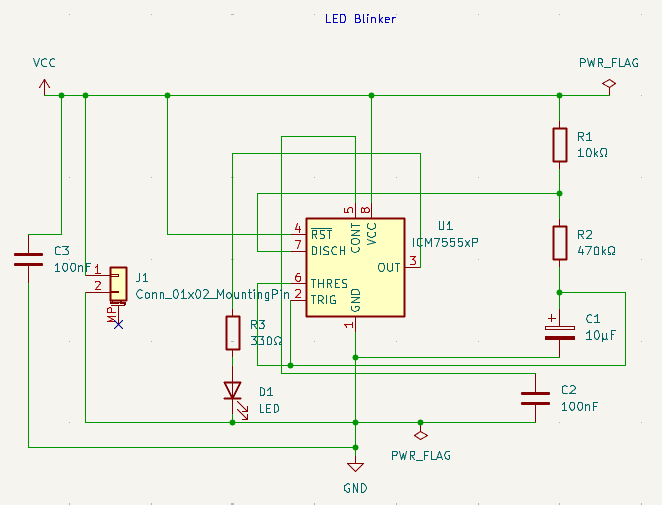
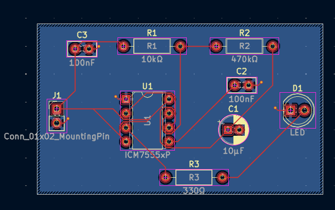
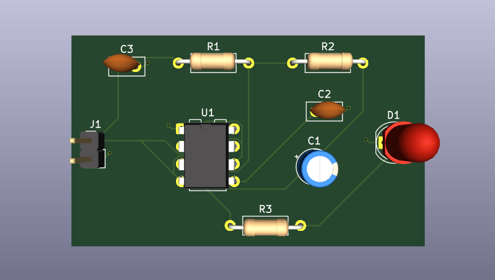

# LED Blinker PCB — 555 Astable Timer Circuit

**Status:** Schematic and PCB layout designed in KiCad. SPICE simulation, ERC/DRC results, manufacturing export, assembly, and bench testing are not yet documented here. Timing figures below are calculated from the standard 555 astable equations, not measured.

## What This Is

A free-running LED blinker built around an ICM7555xP (CMOS 555 timer) wired as an astable oscillator. R1, R2 and C1 set the blink rate; the timer output (pin 3) drives a red LED through a 330 Ω current-limiting resistor. It is the follow-up to the [LED-PCB-Documentation](https://github.com/nizarbadriali/LED-PCB-Documentation) project, adding an active timing circuit to the simple resistor + LED design.

## How the Circuit Works

| Block | Parts | Role |
| ----- | ----- | ---- |
| Timer | U1 (ICM7555xP) | Astable oscillator. RST (pin 4) is tied to VCC so the timer always runs. |
| Timing network | R1 (10 kΩ), R2 (470 kΩ), C1 (10 µF) | C1 charges through R1 + R2 and discharges through R2 via DISCH (pin 7). THRES and TRIG (pins 6 and 2) are tied together on the C1 node. |
| Control-voltage bypass | C2 (100 nF) | CONT (pin 5) to GND, keeps the internal threshold reference quiet. |
| Supply decoupling | C3 (100 nF) | VCC to GND near the timer. |
| Output stage | R3 (330 Ω), D1 (LED) | Pin 3 → R3 → D1 → GND. |
| Power input | J1 (2-pin header) | Pin 1 = VCC, pin 2 = GND. |

## Results

| Parameter | Value | Evidence or qualification |
| --------- | ----- | ------------------------- |
| Output high time | ≈ 3.33 s | Calculated: 0.693 × (R1 + R2) × C1, nominal values |
| Output low time | ≈ 3.26 s | Calculated: 0.693 × R2 × C1, nominal values |
| Period / frequency | ≈ 6.6 s / ≈ 0.15 Hz | Calculated: 1.44 / ((R1 + 2·R2) × C1) |
| Duty cycle | ≈ 50.5 % | Calculated: (R1 + R2) / (R1 + 2·R2) |
| LED current | pending | Depends on supply voltage and LED forward voltage; to be simulated and measured |
| ERC / DRC / parity | pending | Results not yet uploaded |
| Manufacturing package | pending | Gerbers and drills not yet exported |

Real timing will differ from these numbers: a 10 µF electrolytic commonly has a −20 %/+20 % or wider tolerance, and resistor tolerance adds to that. Treat the figures as a prediction until measured with a stopwatch or scope.

## Quick Start

**View the design:** Open the `.kicad_pro` file in the `kicad/` folder in KiCad, then open the schematic and PCB from the project manager.

**Run the simulation:** *(pending)* Add the LTspice circuit to `simulation/ltspice/` and describe how to run the transient analysis here.

## Bill of Materials

| Reference | Value | Package / specification | Selection status |
| --------- | ----- | ----------------------- | ---------------- |
| U1 | ICM7555xP | 8-pin DIP | Confirm supply range and output drive in the datasheet; part number pending |
| R1 | 10 kΩ | Axial through-hole | Tolerance and part number pending |
| R2 | 470 kΩ | Axial through-hole | Tolerance and part number pending |
| R3 | 330 Ω | Axial through-hole | Tolerance and part number pending |
| C1 | 10 µF | Radial electrolytic; **polarised** (+ toward the R2 / pin 2 / pin 6 node) | Voltage rating and part number pending |
| C2 | 100 nF | Through-hole ceramic | Voltage rating and part number pending |
| C3 | 100 nF | Through-hole ceramic | Voltage rating and part number pending |
| D1 | LED | 5 mm through-hole | Colour, part number, polarity marking, and ratings pending |
| J1 | 2-pin header | 2.54 mm pitch; pin 1 = VCC, pin 2 = GND | Manufacturer part number pending |

## Project Files

| Path | Contents |
| ---- | -------- |
| `kicad/` | Project, schematic, PCB, screenshots, and manufacturing ZIP (to be added) |
| `simulation/` | Simulation files |
| `models/` | LED and timer model directives |
| `workdir/` | Supporting data |
| `DESIGN_NOTES.md` | Design decisions, revisions, checks, and fabrication details (to be written) |

## Limitations and Next Steps

- Add the supply voltage this board is designed for, and confirm it is within the ICM7555 and LED ratings.
- Run ERC, DRC, and schematic-to-PCB parity checks and upload the results.
- Simulate the astable timing and LED current, then compare against the calculated values above.
- Select real part numbers and check datasheets against the footprints.
- Assemble, measure the blink period, and compare with prediction before claiming physical validation.

## Tools and Attribution

- KiCad: schematic and PCB design (record the exact version from the project files).
- ICM7555 datasheet: reference for the astable timing equations and pin functions.

## License

MIT License. See [LICENSE](LICENSE).